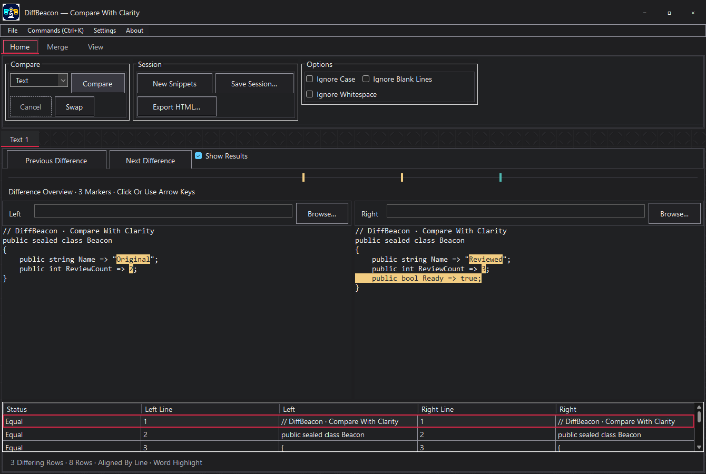
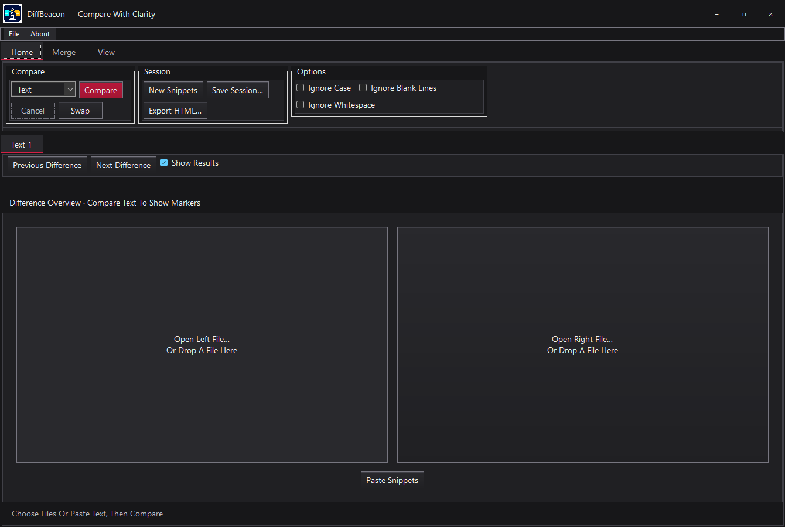
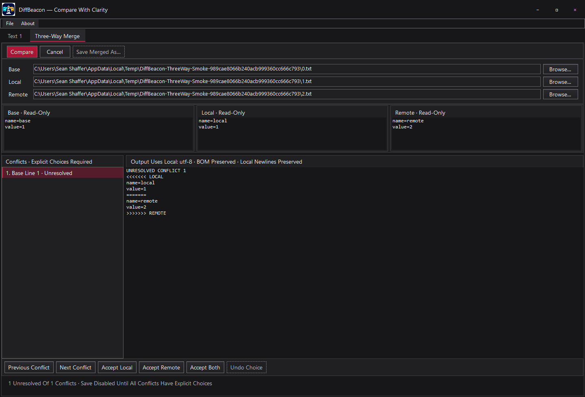
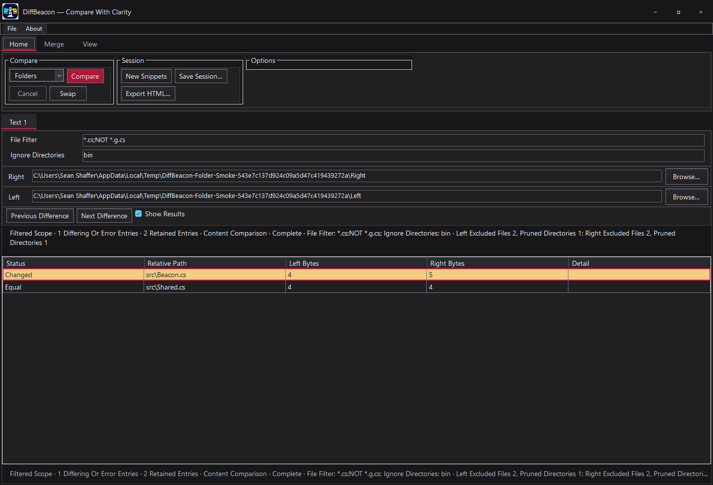

# DiffBeacon

Compare text, folders, binary files and CSV locally, with explicit merge choices and safe saves.

A native **C# / .NET 10 Windows Forms** app with VaporGrid Revision 5 styling and Dark as the default appearance. Free to run locally, with no mandatory paid software or services.

**v0.2.0-beta.1 · First public beta for testing.** Feature completeness, stable readiness and full replacement readiness remain outstanding.

## Download and run

1. Open the [beta release](https://github.com/SeanShaffer88/DiffBeacon/releases/tag/v0.2.0-beta.1) and download the Windows x64 ZIP.
2. Install the **.NET 10 Desktop Runtime for Windows x64** if needed.
3. Extract the entire ZIP, then run **DiffBeacon.exe** from the extracted directory.

The Windows x64 package is unsigned and framework-dependent. You need the Desktop Runtime even when another .NET runtime is installed.

Choose a mode, select two paths and click **Compare**. For snippets, leave paths blank and paste into the Text editors. Merge actions update editors. Use **Save Left As…**, **Save Right As…** or **Save Merged As…** to write files explicitly.

## What you can do

- **Review and edit text** with aligned differences, Line/Word/Character highlighting, synchronized scrolling, an overview map and difference navigation.
- **Merge deliberately** with selected-text or strict aligned-block actions, bounded merge undo and Base/Local/Remote conflict choices.
- **Save with safeguards** that preserve supported Unicode encoding, BOM and newline convention, reject stale files and retain backups on replacement.
- **Compare recursive folders** by content with basename filters, exclusions, ignored directories and explicit incomplete-scan reporting.
- **Inspect binary and table differences** through streamed full-file binary checks and positional CSV/TSV cell comparison.
- **Keep your workflow local** with comparison tabs, path/options sessions, escaped HTML reports, CLI equality checks and opt-in Git difftool setup.

See [usage and hard limits](docs/USAGE.md), [CLI and Git setup](docs/CLI.md), and the [implemented and planned feature matrix](docs/FEATURES.md).

More app screenshots

### Startup workspace

### Three-way merge

### Folder comparison

## Beta limits

Text editing and alignment have explicit size budgets. Folder and table modes are read-only. Large-file binary scans retain limited samples. Advanced document formats, folder synchronization and Git mergetool remain planned. Review [all limits and save behavior](docs/USAGE.md#limits) before working with important files.

**Known issue** — toggling Word Wrap between typing and Undo can lose native typing undo history. Physical DPI/text scaling, live high contrast and full accessibility acceptance are incomplete. See [beta release notes](docs/releases/v0.2.0-beta.1.md) and [verification evidence](docs/VERIFICATION.md).

## Build and modules

Use the **.NET 10 SDK on Windows**. The app and libraries use the installed framework and standard library.

Build, package and smoke commands are in [Build and verify](docs/USAGE.md#build-and-verify). Five reusable net10.0 libraries expose text, file, format and session logic. See [module boundaries and local consumption](docs/MODULES.md).

## License and attribution

[MIT](LICENSE) · [VaporGrid adaptation and attribution](docs/VAPORGRID.md) · [Product specification](docs/SPEC.md)
