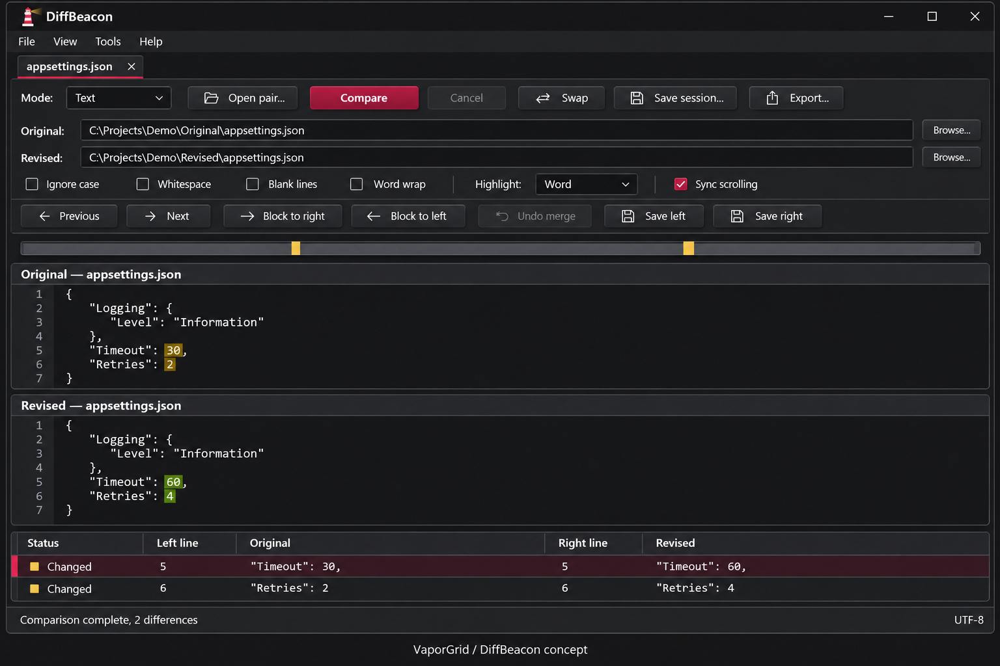
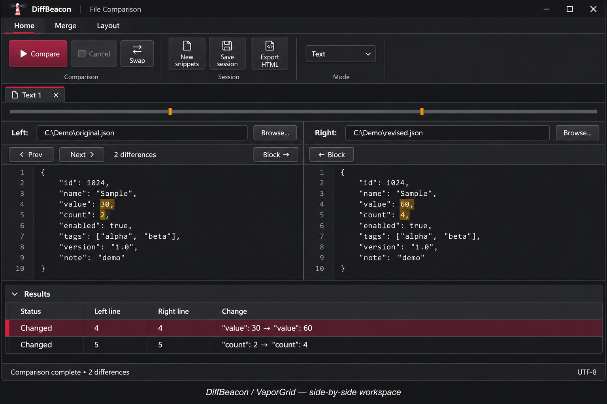

# VaporGrid Revision 5 native adaptation

The design source is [VaporGrid Revision 5](https://github.com/SeanShaffer88/VaporGrid/tree/729fe1ef4492f16e4f94c6198135fad5b6ba8385). DiffBeacon maps its sRGB colors and material guidance to native WinForms controls. The neutral Compare action, separate selection and focus cues, and opaque comparison panes keep attention on the two files. The optional square tread is confined to exposed dark workspace surfaces.

Dark remains the default. **Settings → Appearance** offers System, Light, and Dark, independently of the Crimson, Blue, and Teal accent presets. Display settings are stored beside the portable application in `data/appearance.json` after a user changes them. Windows high contrast uses system colors and a flat workspace.

**Commands** or **Ctrl+K** opens the keyboard command palette for the current session. The comparison editors retain native document scrolling, and the results pane scrolls through the bounded result set. These are data surfaces inside a fitted task layout. See [verification](VERIFICATION.md) for package checks and the tested display envelope.

## Revision 3 history

DiffBeacon uses native WinForms controls, RichEdit editing, keyboard handling, safe prompt defaults, and its real lighthouse application icon. No framework or dependency is introduced. The visual reference is VaporGrid revision 3 at `46710312163f4b2ca0fba568eb612f2c8149bf5a`.

The application uses the dark palette by explicit product request: charcoal Background `#171719`, Surface `#202023`, Raised `#29292D`, Foreground `#F1F1F3`, and Muted `#B7B7C1`. Crimson `#D61F45` marks selection; `#FF4D73` marks keyboard focus independently. Warning, success and danger roles remain separate. Meaningful boundaries use a brighter border than the decorative `#404047` compartment rim.

Existing native buttons retain their click, mnemonic, keyboard, dialog-result and accessibility semantics. Paint-only decoration supplies shallow relief, a `#B8183A` to `#A21533` Compare gradient, solid hover fills, stationary inset pressed states, and solid muted disabled states with dashed boundaries. Drawing resources are scoped and disposed; repeated theme application does not duplicate event subscriptions. Content stays flat and opaque. Tabs, lists and grids keep structural selection indications without requiring focus. No animation or background work is added.

Windows high contrast uses system colors, visible boundaries and focus, without gradients or material relief. Native file dialogs remain OS-managed. This is a **dark adaptation**, not full conformance to the reference's System/Light/Dark selector: no light mode or theme selector was requested. Native field borders and scrollbars remain platform-rendered; field inset styling and platform glyph appearance may vary.

The supplied generated concept is illustrative only. Its “Open pair” label, line-number gutter and decorative imagery do not establish shipped features or authorize replacing existing actions. Production retains its actual controls and lighthouse icon. The mockup is not runtime, DPI, keyboard or accessibility evidence.

## Verification scope

The 2026-11-05 native layout pass builds and runs successfully on Windows x64. Native smoke covers fresh startup before visiting command tabs, both editor orientations at 900/1140/1260×620, command bounds on every deck page and comparison mode, per-session command ownership and disposal, editor selection/viewport/typing undo preservation during orientation changes, merge undo, results collapse and comparison cancellation. It retains the existing prompt, caption, lazy-decoration and stale-generation checks. The coordinator verified real fixture comparison, synchronized Ctrl+End/reverse-wheel scrolling and visible word highlights. Exact build identities and limits are in [verification](VERIFICATION.md). Fresh regular-startup recheck, mixed DPI/text scaling, full keyboard acceptance and real high-contrast switching remain separate gates; this is not an accessibility certification. The existing WordWrap setter's typing-undo limitation is recorded separately from orientation preservation.

## Comparison workspace layout

The second generated concept guided hierarchy rather than adding depicted features. The native implementation uses a grouped Home/Merge/View deck above session tabs; each view owns its controls while the main window hosts the selected deck. Home separates Compare, Session and Options. Merge separates Apply Changes, History and Save. View separates Layout, Differences and Scrolling. The deck is hidden for three-way sessions, which retain their dedicated workflow.

Text opens side by side, with pane identity, path and Browse above each editor. Stacked Editors preserves the actual RichEdit controls, text, selection, dirty flags, native typing history and comparison navigation. Split proportions survive resizing, with minimum viewport clamps. The horizontal difference overview and Previous/Next remain near the workspace. Show Results remains reachable when the grid is collapsed. The two startup targets accept independent file selection/drop, and Paste Snippets focuses the real editor. Non-Text modes retain a shared two-path header and their existing mode-specific options.

The overview retains its horizontal track above the caption in both empty and populated states. Font-measured caption height, scaled track/selection/focus geometry, a clear track-to-text gap and bottom padding prevent clipping. Narrow captions use ellipsis within the available width. Native bitmap checks include Segoe UI 14pt and 18pt; physical mixed-DPI acceptance remains separate.

The mockups are design artifacts, not runtime evidence. Current native captures are under `artifacts/VaporGrid-Layout.*.png`, including all three command pages, side-by-side, stacked, empty and narrow layouts. No line-number gutter or new merge capability is implied by the concept.

See [attribution](VaporGrid-ATTRIBUTION.md).
